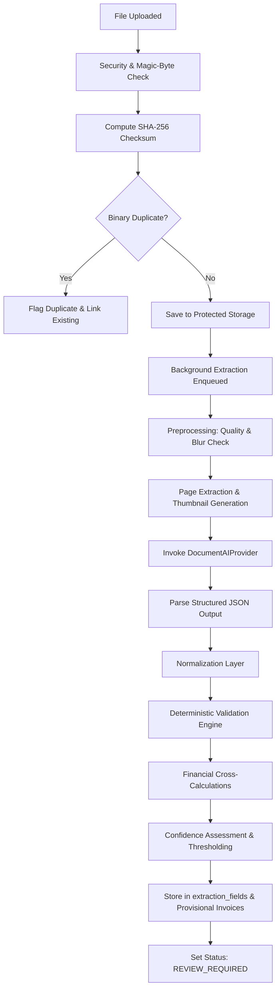

# AI Document Intelligence Pipeline Specification

## 1. End-to-End Pipeline Workflow

---

## 2. Pipeline Execution Stages

### Stage 1: Preprocessing & Quality Gate
- **Orientation & EXIF Correction:** Automatically rotates photos based on EXIF tag 274.
- **Blur Detection:** Calculates Laplacian variance of grayscale image:
  $$\text{Variance} = \text{Var}(\nabla^2 I)$$
  If $\text{Variance} < 100.0$, image is flagged as potentially blurry with a user advisory.
- **PDF Conversion:** For multi-page PDF documents, extracts high-resolution page bitmaps (PNG) for visual preview and bounding box overlays.

### Stage 2: Multimodal Semantic Extraction
- The preprocessed document is submitted to the configured `DocumentAIProvider`.
- Strict schema enforcement requires:
  - Header data: Vendor profile, invoice identifiers, timestamps, currency.
  - Item table: Array of line items with quantities, units, prices, discounts, taxes, totals.
  - Footer data: Subtotal, total tax, service charge, discounts, grand total, payment terms.
  - Dynamic domain fields: Key-value bag for medicine batch/expiry, restaurant table/waiter, utility units, etc.

### Stage 3: Normalization Layer
- **Dates:** Transformed from variable formats (`25/09/2026`, `25-Sep-2026`, `09/25/2026`) into standard ISO-8601 `YYYY-MM-DD`.
- **Currencies:** Transformed from symbols (`Rs.`, `PKR`, `Rs`, `$`, `USD`) into ISO-4217 currency codes (`PKR`, `USD`).
- **Numbers:** Strips thousand separators, commas, and currency prefixes, converting into exact `Decimal` values.

### Stage 4: Deterministic Financial Validation
- Validates arithmetic across all levels.
- Identifies any discrepancy exceeding $\pm 0.05$ currency units.
- Generates precise validation alerts displayed in the review interface (e.g., `"Subtotal Rs. 1,000 + GST Rs. 180 = Rs. 1,180 (matches extracted total)"`).

### Stage 5: Confidence & Evidence Mapping
- Fields are assigned confidence tiers:
  - **High ($\ge 90\%$):** Displayed with subtle green check $\checkmark$.
  - **Medium ($70\% - 89\%$):** Displayed normally.
  - **Low ($< 70\%$):** Displayed with amber alert badge $\triangle$ and automatically expanded for user review.
- Bounding boxes are normalized to coordinates $[0.0, 1.0]$, enabling the frontend document viewer to highlight corresponding regions when a user focuses an input field.
