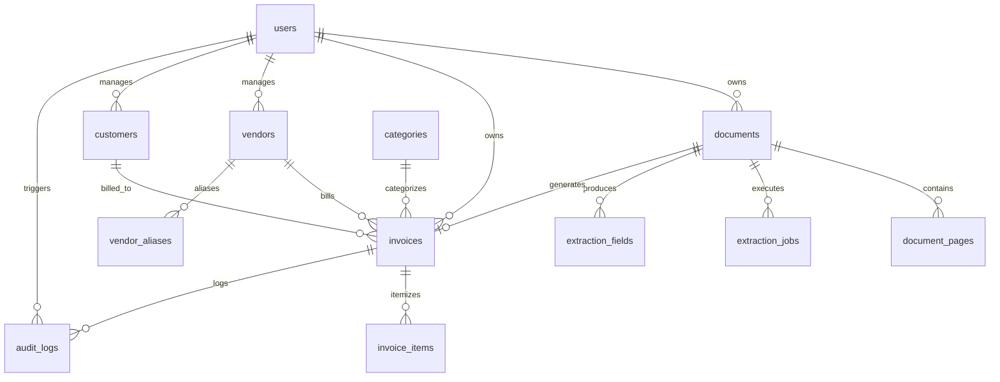

# Relational Database Schema Specification

## 1. Entity-Relationship Overview



---

## 2. Table Specifications & DDL Definitions

### 2.1 `users` Table
Stores authenticated user accounts.
```sql
CREATE TABLE users (
    id VARCHAR(36) PRIMARY KEY,               -- UUIDv4 string
    email VARCHAR(255) UNIQUE NOT NULL,
    hashed_password VARCHAR(255) NOT NULL,
    full_name VARCHAR(150),
    is_active BOOLEAN DEFAULT TRUE NOT NULL,
    is_superuser BOOLEAN DEFAULT FALSE NOT NULL,
    currency VARCHAR(3) DEFAULT 'PKR' NOT NULL,
    created_at TIMESTAMP WITH TIME ZONE DEFAULT CURRENT_TIMESTAMP NOT NULL,
    updated_at TIMESTAMP WITH TIME ZONE DEFAULT CURRENT_TIMESTAMP NOT NULL,
    last_login_at TIMESTAMP WITH TIME ZONE
);
CREATE INDEX idx_users_email ON users(email);
```

### 2.2 `documents` Table
Stores metadata for uploaded bill files.
```sql
CREATE TABLE documents (
    id VARCHAR(36) PRIMARY KEY,
    user_id VARCHAR(36) NOT NULL REFERENCES users(id) ON DELETE CASCADE,
    storage_provider VARCHAR(50) NOT NULL DEFAULT 'local',
    storage_key VARCHAR(500) NOT NULL,
    original_filename VARCHAR(255) NOT NULL,
    mime_type VARCHAR(100) NOT NULL,
    file_size INTEGER NOT NULL,
    sha256_checksum VARCHAR(64) NOT NULL,
    document_type VARCHAR(50) DEFAULT 'unknown',
    status VARCHAR(50) DEFAULT 'UPLOADED' NOT NULL, -- UPLOADED, PROCESSING, EXTRACTED, REVIEW_REQUIRED, VERIFIED, FAILED, ARCHIVED
    page_count INTEGER DEFAULT 1 NOT NULL,
    processing_error TEXT,
    created_at TIMESTAMP WITH TIME ZONE DEFAULT CURRENT_TIMESTAMP NOT NULL,
    updated_at TIMESTAMP WITH TIME ZONE DEFAULT CURRENT_TIMESTAMP NOT NULL
);
CREATE INDEX idx_docs_user_id ON documents(user_id);
CREATE INDEX idx_docs_status ON documents(status);
CREATE INDEX idx_docs_checksum ON documents(user_id, sha256_checksum);
```

### 2.3 `document_pages` Table
Stores individual page representations for multi-page documents.
```sql
CREATE TABLE document_pages (
    id VARCHAR(36) PRIMARY KEY,
    document_id VARCHAR(36) NOT NULL REFERENCES documents(id) ON DELETE CASCADE,
    page_number INTEGER NOT NULL,
    image_storage_key VARCHAR(500) NOT NULL,
    width INTEGER,
    height INTEGER,
    created_at TIMESTAMP WITH TIME ZONE DEFAULT CURRENT_TIMESTAMP NOT NULL,
    CONSTRAINT uq_doc_page UNIQUE (document_id, page_number)
);
```

### 2.4 `extraction_fields` Table
Stores atomic field-level evidence and confidence values.
```sql
CREATE TABLE extraction_fields (
    id VARCHAR(36) PRIMARY KEY,
    document_id VARCHAR(36) NOT NULL REFERENCES documents(id) ON DELETE CASCADE,
    field_name VARCHAR(100) NOT NULL,
    field_value TEXT,
    normalized_value TEXT,
    confidence FLOAT DEFAULT 1.0 NOT NULL,
    source_text TEXT,
    page_number INTEGER DEFAULT 1 NOT NULL,
    bounding_box JSON,                         -- { "x": 0.1, "y": 0.2, "width": 0.3, "height": 0.05 }
    validation_status VARCHAR(50) DEFAULT 'valid',
    user_verified BOOLEAN DEFAULT FALSE NOT NULL,
    created_at TIMESTAMP WITH TIME ZONE DEFAULT CURRENT_TIMESTAMP NOT NULL
);
CREATE INDEX idx_ext_fields_doc ON extraction_fields(document_id);
```

### 2.5 `vendors` Table
Consolidated vendor and merchant profiles.
```sql
CREATE TABLE vendors (
    id VARCHAR(36) PRIMARY KEY,
    user_id VARCHAR(36) NOT NULL REFERENCES users(id) ON DELETE CASCADE,
    name VARCHAR(255) NOT NULL,
    normalized_name VARCHAR(255) NOT NULL,
    phone VARCHAR(50),
    email VARCHAR(255),
    address TEXT,
    website VARCHAR(255),
    tax_id VARCHAR(50),
    ntn VARCHAR(50),
    strn VARCHAR(50),
    created_at TIMESTAMP WITH TIME ZONE DEFAULT CURRENT_TIMESTAMP NOT NULL,
    updated_at TIMESTAMP WITH TIME ZONE DEFAULT CURRENT_TIMESTAMP NOT NULL,
    CONSTRAINT uq_user_vendor_normalized UNIQUE (user_id, normalized_name)
);
CREATE INDEX idx_vendors_user ON vendors(user_id);
```

### 2.6 `customers` Table
Customer metadata when present on invoice documents.
```sql
CREATE TABLE customers (
    id VARCHAR(36) PRIMARY KEY,
    user_id VARCHAR(36) NOT NULL REFERENCES users(id) ON DELETE CASCADE,
    name VARCHAR(255) NOT NULL,
    phone VARCHAR(50),
    email VARCHAR(255),
    address TEXT,
    created_at TIMESTAMP WITH TIME ZONE DEFAULT CURRENT_TIMESTAMP NOT NULL,
    updated_at TIMESTAMP WITH TIME ZONE DEFAULT CURRENT_TIMESTAMP NOT NULL
);
CREATE INDEX idx_customers_user ON customers(user_id);
```

### 2.7 `categories` Table
Expense categories for budgeting and aggregation.
```sql
CREATE TABLE categories (
    id VARCHAR(36) PRIMARY KEY,
    user_id VARCHAR(36) REFERENCES users(id) ON DELETE CASCADE, -- NULL for system-wide defaults
    name VARCHAR(100) NOT NULL,
    color VARCHAR(20) DEFAULT '#6B7280',
    icon VARCHAR(50) DEFAULT 'tag',
    is_default BOOLEAN DEFAULT FALSE NOT NULL
);
CREATE INDEX idx_categories_user ON categories(user_id);
```

### 2.8 `invoices` Table
Core verified financial ledger records.
```sql
CREATE TABLE invoices (
    id VARCHAR(36) PRIMARY KEY,
    user_id VARCHAR(36) NOT NULL REFERENCES users(id) ON DELETE CASCADE,
    document_id VARCHAR(36) REFERENCES documents(id) ON DELETE SET NULL,
    vendor_id VARCHAR(36) REFERENCES vendors(id) ON DELETE SET NULL,
    customer_id VARCHAR(36) REFERENCES customers(id) ON DELETE SET NULL,
    category_id VARCHAR(36) REFERENCES categories(id) ON DELETE SET NULL,
    invoice_number VARCHAR(100),
    receipt_number VARCHAR(100),
    order_number VARCHAR(100),
    invoice_date DATE NOT NULL,
    due_date DATE,
    currency VARCHAR(3) DEFAULT 'PKR' NOT NULL,
    
    subtotal NUMERIC(12, 2) DEFAULT 0.00 NOT NULL,
    discount NUMERIC(12, 2) DEFAULT 0.00 NOT NULL,
    tax NUMERIC(12, 2) DEFAULT 0.00 NOT NULL,
    service_charge NUMERIC(12, 2) DEFAULT 0.00 NOT NULL,
    shipping NUMERIC(12, 2) DEFAULT 0.00 NOT NULL,
    rounding NUMERIC(12, 2) DEFAULT 0.00 NOT NULL,
    total NUMERIC(12, 2) DEFAULT 0.00 NOT NULL,
    amount_paid NUMERIC(12, 2) DEFAULT 0.00 NOT NULL,
    balance_due NUMERIC(12, 2) DEFAULT 0.00 NOT NULL,
    
    payment_method VARCHAR(50),
    confidence_score FLOAT DEFAULT 1.0 NOT NULL,
    verification_status VARCHAR(50) DEFAULT 'UNVERIFIED' NOT NULL, -- UNVERIFIED, VERIFIED, REJECTED
    custom_fields JSON,
    notes TEXT,
    created_at TIMESTAMP WITH TIME ZONE DEFAULT CURRENT_TIMESTAMP NOT NULL,
    updated_at TIMESTAMP WITH TIME ZONE DEFAULT CURRENT_TIMESTAMP NOT NULL
);
CREATE INDEX idx_invoices_user ON invoices(user_id);
CREATE INDEX idx_invoices_date ON invoices(user_id, invoice_date);
CREATE INDEX idx_invoices_vendor ON invoices(user_id, vendor_id);
CREATE INDEX idx_invoices_number ON invoices(user_id, invoice_number);
```

### 2.9 `invoice_items` Table
Individual line items itemized on the bill.
```sql
CREATE TABLE invoice_items (
    id VARCHAR(36) PRIMARY KEY,
    invoice_id VARCHAR(36) NOT NULL REFERENCES invoices(id) ON DELETE CASCADE,
    item_order INTEGER DEFAULT 0 NOT NULL,
    name VARCHAR(255) NOT NULL,
    description TEXT,
    sku VARCHAR(100),
    quantity NUMERIC(10, 3) DEFAULT 1.000 NOT NULL,
    unit VARCHAR(50),
    unit_price NUMERIC(12, 2) DEFAULT 0.00 NOT NULL,
    discount NUMERIC(12, 2) DEFAULT 0.00 NOT NULL,
    tax NUMERIC(12, 2) DEFAULT 0.00 NOT NULL,
    line_total NUMERIC(12, 2) DEFAULT 0.00 NOT NULL,
    confidence FLOAT DEFAULT 1.0 NOT NULL,
    bounding_box JSON,
    created_at TIMESTAMP WITH TIME ZONE DEFAULT CURRENT_TIMESTAMP NOT NULL
);
CREATE INDEX idx_items_invoice ON invoice_items(invoice_id);
```

### 2.10 `audit_logs` Table
Financial audit log tracking every data creation, change, or deletion.
```sql
CREATE TABLE audit_logs (
    id VARCHAR(36) PRIMARY KEY,
    user_id VARCHAR(36) NOT NULL REFERENCES users(id) ON DELETE CASCADE,
    action VARCHAR(100) NOT NULL,             -- UPLOAD, EXTRACT, EDIT, VERIFY, DELETE, MERGE
    entity_type VARCHAR(50) NOT NULL,         -- document, invoice, vendor
    entity_id VARCHAR(36) NOT NULL,
    before_state JSON,
    after_state JSON,
    ip_address VARCHAR(45),
    created_at TIMESTAMP WITH TIME ZONE DEFAULT CURRENT_TIMESTAMP NOT NULL
);
CREATE INDEX idx_audit_user ON audit_logs(user_id);
CREATE INDEX idx_audit_entity ON audit_logs(entity_type, entity_id);
```
